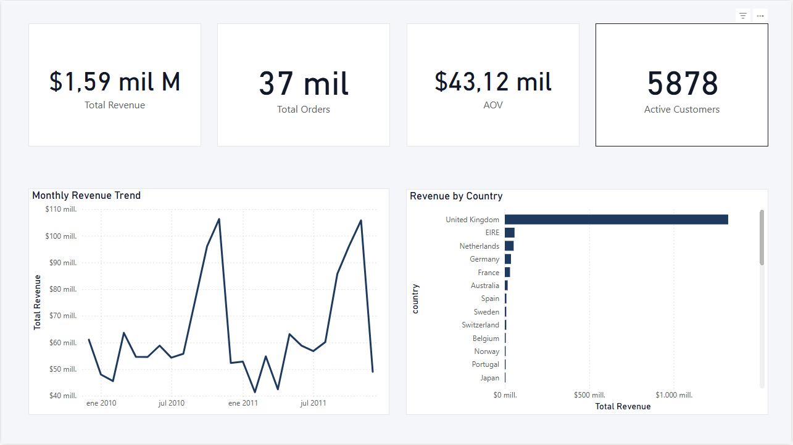

# Retail SQL & Power BI Analytics

## Project Overview

End-to-end retail analytics project combining **Python**, **SQLite**, and **Power BI** to transform raw transactional data (2009–2011) into a structured analytical schema and an interactive dashboard.

The workflow covers:
- **ETL & Data Ingestion:** Loading and concatenating multi-sheet Excel records (`Online Retail II`) with Python (`pandas`).
- **Data Cleaning & Modeling:** Filtering invalid transactions/returns, standardizing customer and date fields, and building analytical tables (`customers`, `products`, `sales`) in SQLite.
- **SQL Business Analysis:** Querying core KPIs, customer rankings, and product performance.
- **Executive Reporting:** Designing a Power BI report tracking revenue, order volume, AOV, active customers, monthly seasonality, and country distribution.

---

## Dashboard Preview




---

## Dataset

This project uses the **Online Retail II Dataset**, containing real transactional records from a UK-based online retailer across **2009–2011**, including:
- Invoice numbers and transaction timestamps
- Product stock codes, descriptions, and unit prices
- Customer IDs and country-level geographic data

---

## Tech Stack

- **Python:** `pandas`, `sqlite3`, `openpyxl`
- **SQL:** SQLite (schema design, joins, aggregations, window functions)
- **Business Intelligence:** Power BI Desktop (DAX measures, data modeling, time-series & bar visualizations)
- **Jupyter Notebook:** Exploratory data analysis (`notebooks/analysis.ipynb`)

---

## Project Structure

```text
retail-sql-analytics/
│
├── data/
│   ├── raw/
│   │   └── online_retail_II.xlsx
│   └── processed/               # CSV exports feeding Power BI
│
├── docs/
│   ├── powerbi_overview.png     # Final Power BI dashboard screenshot
│   ├── Monthly Revenue Trend.png
│   ├── Top 10 Customers by Spending.png
│   └── Top 10 Products by Revenue.png
│
├── notebooks/
│   └── analysis.ipynb
│
├── powerbi/
│   └── retail_analytics.pbix    # Power BI Desktop report
│
├── scripts/
│   └── load_and_clean.py        # Multi-sheet ingestion & SQLite pipeline
│
├── sql/
│   ├── 01_cleaning.sql
│   ├── 02_schema.sql
│   ├── 03_kpis.sql
│   └── 04_ranking.sql
│
├── retail.db
├── requirements.txt
└── README.md
```

---

## Data Pipeline & Relational Model

The pipeline in `scripts/load_and_clean.py` automates ingestion and transformation:
1. Reads and concatenates all sheets from `online_retail_II.xlsx`.
2. Removes records with missing `CustomerID`, returns/cancellations, and invalid prices/quantities.
3. Loads raw data into SQLite (`retail`) and executes `01_cleaning.sql` and `02_schema.sql`.
4. Produces analytical tables ready for SQL querying and Power BI reporting:
   - **`customers`** (`customer_id`, `country`)
   - **`products`** (`product_id`, `description`, `price`)
   - **`sales`** (`sale_id`, `invoice`, `customer_id`, `product_id`, `quantity`, `price`, `sale_date`)

---

## Key Business Insights (2009–2011)

- **Scale & Core Metrics:** Processed **~37K valid orders** across **5,878 active customers**, generating **~$1.59M** in total revenue.
- **Strong Q4 Seasonality:** Monthly revenue shows consistent year-end peaks in **November–December** across both 2010 and 2011, driven by holiday demand.
- **Geographic Concentration:** **United Kingdom** dominates total revenue by a wide margin, followed by European markets such as **EIRE**, **Netherlands**, **Germany**, and **France**.
- **Pareto Revenue Distribution:** A relatively small segment of repeat customers and top-selling SKUs accounts for a disproportionate share of overall sales.

---

## How to Run

1. **Clone the repository**
   ```bash
   git clone <your-repository-url>
   cd retail-sql-analytics
   ```

2. **Install Python dependencies**
   ```bash
   pip install -r requirements.txt
   ```

3. **Run the ETL & SQLite pipeline**
   ```bash
   python scripts/load_and_clean.py
   ```

4. **Explore the Power BI Dashboard**
   Open `powerbi/retail_analytics.pbix` in **Power BI Desktop** and click **Refresh** to load the latest processed tables.

---

## Future Improvements

- RFM (Recency, Frequency, Monetary) customer segmentation page in Power BI
- Cohort retention analysis by acquisition month
- Automated CSV export step integrated directly at the end of `load_and_clean.py`